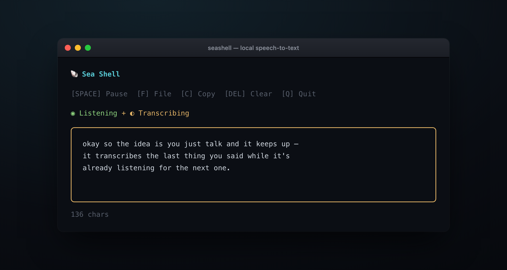

# Sea Shell

Local CI: `bun run ci`. See [local CI](docs/local-ci.md) for prerequisites,
saved reports and the optional pre-push check. Pushes and PRs do not start hosted CI.

To see what works, what is off, and how to fix each item, press **,** in
Seashell for Settings or run `seashell status`.

To use your meetings from Claude Code or Codex, run `seashell mcp install` once.
It adds a local meetings server and a skill, so you can ask things like "what
did we decide in my last call with Dana?", "what has Dana committed to since
October?" or "draft a follow-up from today's sync". Answers cite transcript
segments, and nothing is sent anywhere unless you approve it. When you ask, the
agent can also fix a misheard line, name a speaker, or edit your prompts,
templates, extractors and automations; see [Meetings in Claude Code and Codex](#meetings-in-claude-code-and-codex).

For optional summaries and meeting chat, press **,** in Seashell and choose **AI notes**, or run
`seashell ai setup` to choose models and supported effort levels for live analysis,
final notes and chat. Each role can use Claude Code, Codex, a local model, or OpenRouter.
See [Humain setup](docs/humain-setup.md) for engine installation and provider details.
Capture and transcription work without it.


Local-first speech-to-text for audio, video, live microphone + system-audio
sessions, speaker diarization, subtitles, and a durable transcript library on
macOS.

Sea Shell uses [whisper.cpp](https://github.com/ggerganov/whisper.cpp) with
Metal acceleration. File and live transcription stay on your machine by
default; exact-model cloud drafts/finals require explicit upload consent. Optional
speaker separation downloads a small model once, with no account, and runs on
your Mac.



## What it does

- Transcribes WAV, MP3, FLAC, OGG, Opus, M4A, AAC, MP4, MOV, M4V, MKV, and
  WebM when the installed FFmpeg build supports their codecs.
- Extracts audio streams from video and prepares deterministic 16 kHz PCM for
  Whisper.
- Produces plain text, timestamped text, speaker-aware text, JSON, SRT, and
  WebVTT without rerunning transcription for each rendering.
- Saves successful file and live transcripts to a readable local folder.
- Lets you rename anonymous diarization clusters such as `SPEAKER_00` to human
  names without retranscribing.
- Can conservatively identify clusters from meeting rosters, timestamped
  active-speaker observations, self-introductions, and explicit handoffs.
- Can turn any saved transcript into an optional meeting artifact with notes,
  evidence-linked analysis, cited chat, and friendly Markdown/JSON/subtitle files.
- Keeps the terminal UI transcript-first, with an on-demand history drawer for
  saved recordings, search, speaker labels, timestamps, and exports.
- Keeps command output clean for shell pipelines and AI agents.
- Advertises its local batch transcription through a versioned capability
  manifest so an installed Humain engine can discover and invoke it without
  making either product depend on the other.
- Captures microphone and macOS system audio concurrently for live calls,
  labels the sources separately, skips silent chunks, and suppresses strong
  time-overlapping speaker-playback duplicates from the microphone transcript.
- Keeps live ASR bounded: one owned warm local worker, a measured machine-local
  profile, and optional consented cloud/adaptive routing through Humain.
- Can watch low-cost macOS process-audio signals in the background, start and
  stop durable meeting capture automatically, and defer expensive inference
  until the meeting ends.

## Requirements

The Homebrew installation manages the runtime, tools, and models below for
you. Apple Silicon is recommended; the formula also supports Intel Macs.

- macOS; Apple Silicon is recommended. Live system audio requires macOS 14.2+
- [Bun](https://bun.sh)
- FFmpeg and ffprobe for media inspection and audio extraction
- SoX for live microphone capture
- CMake and Git for building whisper.cpp

Sea Shell's installer can add the Homebrew packages it needs. To install them
yourself instead:

```bash
brew install ffmpeg sox cmake git
```

Speaker diarization needs nothing extra. The optional Python engine needs
Python 3.10+; see [Speaker diarization](#speaker-diarization).
Meeting intelligence optionally uses the separate
[Humain engine](https://github.com/stupart/humain-engine) (currently a private
repository; access is required); ordinary capture,
transcription, diarization, history, and exports do not require it.

## Installation

On a Mac with Homebrew, install the tested **1.1.0-rc6** release candidate:

```bash
brew install stupart/tap/seashell
```

Then run `seashell`. The formula includes a private Bun runtime, native
helpers, and local transcription models; no separate setup or API key is
required. The first installation builds the native tools and downloads the
models, which can take several minutes.

Automatic meeting detection is enabled while the app is open. To also enable
the background meeting watcher at login, run `seashell setup`.

Fresh installations and real local transcription have passed on Apple Silicon
and Intel. See the [RC6 acceptance report](docs/google-meet-acceptance-2026-09-20.md)
for test evidence and remaining limits. The npm package named `seashell`
belongs to a different project; it does not install this app.

### Install from source

For a Git checkout with in-place source updates, use:

```bash
/bin/bash -c "$(curl -fsSL https://raw.githubusercontent.com/stupart/seashell/main/bootstrap.sh)"
```

The bootstrap clones Sea Shell into `~/.local/share/seashell` and runs the
installer. The installer adds missing Bun/Homebrew dependencies, builds
whisper.cpp with Metal, downloads the Whisper large-v3-turbo and Silero VAD
models, and creates a global `seashell` command.

There is no separate setup step. On a true first install, Sea Shell writes
local-only defaults, saves transcripts in `~/Documents/Sea Shell/Transcripts`,
and starts its lightweight meeting watcher whenever you log into your Mac.
Reinstalling or updating preserves the existing config and launch-at-login
choice byte-for-byte. Set `SEASHELL_SKIP_AUTOSTART=1` on the install command if
you prefer to launch Sea Shell manually; `SEASHELL_SKIP_FIRST_RUN=1` suppresses
all automatic first-run configuration.

macOS itself still asks for Microphone, Screen & System Audio Recording, and
optional Calendar access when each capability is first used. Sea Shell cannot
and should not bypass those system dialogs. Local file/live transcription does
not require an API key, Humain, or a cloud account.

### Updating

For a Homebrew installation:

```bash
brew update && brew upgrade stupart/tap/seashell
```

Git-based installations can update in place; no uninstall is needed:

```bash
seashell update --check
seashell update
```

The updater fetches the current branch's configured remote, permits only a
clean fast-forward, and repairs native helpers, the pinned Whisper backend,
checksum-verified models, and locked Bun dependencies. A failed repair can be
retried with the same `seashell update` command even after Git has advanced. It never
merges divergent history or discards tracked changes. `--json` makes either
command machine-readable. A branch must exist on the remote before it can be
updated this way.

Downloads are verified before replacing installed models; interrupted downloads
are retried on the next install. Installation pins whisper.cpp v1.9.4 and builds
both the batch CLI and the live server. Updates preserve configuration and
launch-at-login choices. For an isolated install, set `SEASHELL_INSTALL_DIR`,
`SEASHELL_BIN_DIR`, and `SEASHELL_CONFIG` to disposable paths and set
`SEASHELL_SKIP_AUTOSTART=1`.

## Quick start

Open the live transcription and library TUI:

```bash
seashell
```

Transcribe audio or video while preserving the original plain-text shortcut:

```bash
seashell interview.m4a
seashell product-demo.mp4
seashell transcribe meeting.mov --timestamps
seashell transcribe meeting.mov --speakers
seashell transcribe meeting.mov --timestamps --speakers
```

Create subtitle or structured output:

```bash
seashell transcribe demo.mp4 --format srt --output demo.srt
seashell transcribe demo.mp4 --format vtt > demo.vtt
seashell transcribe meeting.mp4 --speakers --format json > meeting.json
seashell transcribe meeting.mp4 --speakers --format srt > meeting.srt
```

Create and enrich a saved meeting:

```bash
seashell meeting setup --backend codex --model <exact-model> --mode hybrid
seashell meeting create <transcript-id>
seashell meeting enrich <transcript-id>
seashell meeting show <transcript-id>
seashell meeting chat <transcript-id> "What did we decide?"
```

Automatic meeting detection is on by default while the TUI is open. The source
installer also enables launch at login on a first install; Homebrew installation
does not enable it. Inspect or change the separate login watcher with:

```bash
seashell meeting autostart status
seashell meeting autostart disable
seashell meeting autostart enable
```

This installs a per-user macOS LaunchAgent for the Sea Shell watcher; Humain is
not a daemon and is invoked only when optional meeting intelligence is
configured. Advanced policies remain configurable through `seashell meeting
setup`; ordinary users do not need to run it.

Inspect what Sea Shell can contribute to Humain or another compatible host:

```bash
seashell capabilities --json
```

Progress and save locations are written to stderr. Transcript content is the
only data written to stdout, so piping remains reliable.

### Automatic meetings and Google Meet

With **V → Connect Google Meet · Accessibility** enabled, Sea Shell reads
joined-call state through native Accessibility (Chrome first; Safari is
experimental). It starts after two confirming polls, normally about 3–6 seconds,
and can start while you are muted. Confirmed departure ends capture at the next
check; a different room creates a separate transcript. An unreadable interface
never proves departure. An existing call can continue while matching browser
microphone activity corroborates it; without either signal, the end grace
applies. Accessibility is enabled through macOS setup, without a browser
extension or developer setting. The saved start time is when capture begins;
audio from before capture cannot be recovered.

For other apps, Sea Shell detects which macOS process is actively using audio input. A
dedicated meeting app such as Zoom, Teams, Webex, or FaceTime starts
automatically after two confirming polls. Browser audio from Chrome, Safari,
Arc, Edge, Brave, or Firefox also starts automatically when a current Calendar
event corroborates it. Browser audio without a matching event asks by default
because it could be a voice form, recording site, or another non-meeting use.
The TUI accepts `M`/`X`; the background watcher posts a notification and accepts
`seashell meeting consent approve|decline`. Calendar data alone never starts
recording.

Once started, Sea Shell atomically commits microphone and system-audio WAV
chunks on one session clock. The background watcher also creates local live
transcript drafts from those saved chunks, using one lazily started Whisper
server and a bounded queue. If transcription falls behind, audio continues to
save and the final pass fills draft gaps. Diarization runs after capture.
A confirmed Meet departure stops
capture immediately at the next poll. Other app signals and unreadable Meet
pages use a 20-second grace period before stopping. Sea Shell queues final transcription, optional local
diarization and attendee-backed speaker labeling, and optional Humain notes.
The watcher can re-arm while prior post-processing finishes. If system audio
permission fails, useful microphone-only capture continues; if the microphone
fails, available computer audio still saves. A model failure
cannot delete already committed audio.

The TUI and background watcher share one per-user lock. Opening Sea Shell while
the login watcher owns capture gives a live library view without starting a
second recorder. In a wide terminal, History opens on the left automatically.
Each call appears as soon as capture starts, with its time and a recording (●)
or processing (◐) indicator. Open entries refresh as draft text arrives, then
show the refined final transcript. Source health, saved-audio progress, and
draft status remain separate so a delayed transcript cannot look like a stopped
recorder.
Press **H** to show or hide History; narrow terminals use a drawer.
The login watcher continues after the TUI closes and re-arms for the next call.
Logs live under `~/Library/Application Support/Sea Shell/Logs`.
An experimental Google Meet reader uses native macOS Accessibility to read
meeting controls, participant names, and exposed speaking indicators. Start with
Google Chrome; Safari compatibility is not yet verified. Press **V → Connect
Google Meet · Accessibility**, or run `seashell meeting speakers setup` and reopen
Seashell. Setup requests access for both this window and the background host.
Allow the entries macOS shows in **System Settings → Privacy & Security →
Accessibility**, then run `seashell meeting speakers check` to verify both scopes.
Terminal access alone does not enable background meeting detection.
Background meetings record your microphone through a small native helper,
**Seashell Microphone**, which holds its own macOS Microphone permission (the
background runtime itself cannot be granted one). Run
`seashell meeting microphone setup` once and choose **Allow**; check it any time
with `seashell meeting microphone`. Other people in a call are recorded from your
Mac's sound. Meetings keep the background recorder's permission for this until
you allow **Seashell System Audio**, the helper's own, at your Mac: press **,**
→ Computer audio → **Enter**, or run `seashell meeting computer-audio setup`.
Seashell plays a short sound, macOS asks once, and from the next call meetings
use it. No call waits on a question nobody is there to answer. If macOS later
refuses it, or it sends only silence, the recording goes back to the background
recorder's permission. When the call is then heard, macOS had refused it: Seashell
says so once and starts later calls with the background recorder's permission.
A quiet lobby is not mistaken for that. If you leave a call and rejoin within three
minutes, the recording continues in the same History entry. To name meetings
after their calendar event, press **,** → Meeting titles from Calendar (or run
`seashell meeting calendar setup`); **Seashell Calendar** asks macOS once. Use
`seashell meeting merge --auto --dry-run` to find older meetings that were split.
The background runtime stays at
`~/Library/Application Support/Sea Shell/Runtime/Seashell Background`
so its path does not change with each Homebrew release. Its executable is named
**Seashell Background**; macOS controls the name shown in permission settings.
Older installations need
one migration: finish recording, run `seashell meeting autostart enable`, then
`seashell meeting speakers setup` and allow the new entry macOS shows.
No extension or browser developer setting is required. Normal launch, background
watching, and connection checks never request this permission automatically.
For names while your Meet microphone is unmuted, keep Meet's **People /
Participants** panel open so Seashell can distinguish you from remote speakers.
With the Meet microphone muted, that panel is not required. Otherwise naming
pauses safely while audio recording continues. Safari names are unverified;
vision-based speaker detection is not implemented.
These are fallible timing hints, not isolated participant audio; see the
[Meet setup and test guide](docs/meet-speakers.md).
Calendar attendees, self-identification, explicit handoffs, and supplied
timestamp evidence remain additional identity sources. Headphones are optional:
computer audio is captured directly, independently of what the speakers play.
With laptop speakers, playback can also reach the microphone. Seashell reduces
strong transcript duplicates, but this is not acoustic echo cancellation; review
attribution when echo or people sharing a room make sources ambiguous.

Output-device changes, and computer audio that stops arriving, reconnect as
often as needed. The meeting stays one recording, with its saved audio and
timing gaps. The microphone follows default-input changes the same way, in
whatever format the new device uses. Physical unplug/replug and speakerphone
quality still need device acceptance.

Before the meeting, prove both inputs with a disposable five-second check while
speaking and playing computer audio:

```bash
seashell capture test --seconds 5
```

The test reports microphone and system signal independently and deletes only
its own test recording. During capture, the status row labels **Microphone** and
**Computer audio** separately. “Starting…” means the source is still opening;
computer audio “ready” means the helper opened, and its meter appears after the
first audio buffer. Readiness alone does not prove an audible signal. The
background recording view shows saved-audio progress separately from live text.
Quiet input may mean silence or mute; it is not a permission diagnosis. Source
warnings remain attached to the saved meeting, including after recovery or
completion. Receiving audio or detecting sound does not prove intelligible
speech was captured. See the [capture health contract](docs/recording-confidence.md).

With the TUI and login watcher stopped, run one cheap detection probe without
recording a full meeting (only one watcher can own detection):

```bash
seashell meeting watch --once --json
```

For a solo Google Meet check, open Sea Shell in its idle automatic mode (pause
any manual recording first), then join an instant meeting with the microphone
on. Without a matching calendar event, expect a browser recording prompt after
two polls and press **M** to accept it. Speak a recognizable test phrase; play
some known speech on the computer to exercise the second track, since a solo
Meet has no remote participant audio. Leave the call, allow the 20-second end
grace period and finalization, then check the saved meeting for both phrases.
This checks the real detection/capture/save path; the automated meeting soak
uses simulated detection and transcription.

### Running alongside Conch

Conch and Sea Shell currently own separate microphone streams and Whisper
workers. Reusing the same model file can save disk space, but does not share a
loaded model or transcription work. Conch's optional `meeting-autopause` setting
pauses it when another app uses a microphone; this can also include Sea Shell's
manual recording. It is microphone-activity detection, not a shared meeting
protocol. Conch's spoken output can appear in Sea Shell's computer-audio track.

A shared local transcription service could avoid duplicate model memory and
schedule short Conch requests alongside meeting work. That needs separate
request ownership, cancellation, and result routing: a meeting transcript
must not become a Conch voice command. No shared service or transcript feed is
implemented yet.

### Live performance and routing

Capture is durable before inference. CoreAudio writes only to a preallocated
bounded handoff; conversion, disk durability, hashing, and transcription happen
off its real-time callback. The local draft queue is bounded and uses one
Sea Shell-owned warm Whisper server, which shuts down after idle time or quit.
It never attaches to an unrelated server already running on the computer.

Local is the default. Optional cloud and adaptive modes require Humain, an exact
OpenRouter STT model, and explicit upload consent in the Sea Shell config. The
canonical final route is pinned separately, so adaptive cloud drafts do not
silently turn the saved transcript into a cloud result. See
[`docs/live-performance-routing-0.1.md`](docs/live-performance-routing-0.1.md)
for the config and clock contract.

Benchmark the exact local model on this computer with a representative 16 kHz
mono WAV:

```bash
bun run benchmark:live-asr -- ./sample.wav
```

## Recording settings

Seashell records calls by itself. To record anything else, press **Space** in
Seashell or run `seashell record`; stop with **Space** or `seashell record stop`.
A recording started by hand runs until you stop it. Stopping a call by hand keeps
that call stopped until it ends.

Whether a call records by itself, asks first, or never records:

```bash
seashell meeting setup --automation automatic --browser-without-calendar automatic   # never ask
seashell meeting apps                     # each app and its setting
seashell meeting apps facetime off        # on, off or ask, per app
```

A Google Meet, Zoom or Teams call on your calendar records by itself even when
Seashell cannot read the Meet page, which happens whenever Meet is full screen,
on another desktop or in a background tab. When a call does need a yes, Seashell
asks with a dialog, so it is answered even with no Seashell window open.

### Meeting video

While it records a call, Seashell also records the call's window: the browser
window with the Meet in it, or the Zoom, Teams or FaceTime window. Whatever
anyone shares in the call shows in that window, so it is in the video. The
window is recorded even on another desktop or under other windows. When no
window of the call's app fits, Seashell records the main display instead and
says so.

Video needs macOS Screen Recording access, once, for the helper named
**Seashell Screen Capture**:

```bash
seashell meeting video setup      # macOS asks; turn on Seashell Screen Capture
seashell meeting video --status   # check, without asking
```

Until then, calls still record their audio and Seashell warns that video was
skipped. In Seashell, press **,** and choose **Video**: Enter asks macOS for
Screen Recording, and Space turns video on or off.

A recording you start yourself has video only when you ask for it. In Seashell,
**Shift+V** records with video and **Space** records audio only. From a terminal:

```bash
seashell record --video                 # the call's window if one is open, otherwise the main display
seashell record --video --window zoom   # one app's window, by id or name
seashell record --video --display 2     # a whole display; 1 is the main display
```

Watch a meeting's video beside its transcript:

```bash
seashell meeting video <id>              # opens video.html from the meeting folder
seashell meeting video <id> --at 12:34   # opens at that moment
```

In Seashell, press **W** in a meeting that has video. It opens at the
transcript line at the top of the screen, or at the start from Notes or Chat.
Click a line to see that moment; the line being said is highlighted. The page
works offline. The video has no sound of its own: the transcript carries the
words.

Turn video off, or off for one app:

```bash
seashell meeting video off
seashell meeting video facetime off      # on or off, per app
```

In `config.json`, `meeting.video` holds `enabled`, `apps` (per app, by the ids
of `seashell meeting apps`, `true` or `false`), `fps` (1 to 30, default 2) and
`quality` (`low` 1280 px, `medium` 1920 px, the default, or `high` 2560 px):

```json
{ "meeting": { "video": { "enabled": true, "apps": { "facetime": false }, "fps": 2, "quality": "medium" } } }
```

**Where it lives.** Each meeting folder keeps its movies in `capture/video/`
(`000001.mp4`, with a `.json` sidecar), and `video.json` beside the transcript
points at them: video time = transcript time + `startOffsetSeconds`. A call
that pauses and resumes, or a recorder that had to restart, adds a second movie,
listed under `segments`. Movies are H.264, encoded in hardware and written in
4-second fragments, so a crash loses only the last few seconds.

**How big.** Measured on a synthetic screen share (slides changing every 30
seconds, a moving pointer and a talking-head tile), per hour of meeting:

| Setting | MB per hour |
| --- | --- |
| low, 2 fps | 44 |
| medium, 2 fps (default) | 60 |
| high, 2 fps | 73 |
| medium, 5 fps | 73 |
| medium, 15 fps | 106 |
| medium, 30 fps | 156 |

A still slide costs almost nothing. A screen that moves all the time, such as a
shared video, costs up to the encoder's target: about 135 MB an hour at the
default. For comparison, a meeting's own audio (two 16 kHz tracks) is about
230 MB an hour.

## Terminal UI

Sea Shell opens on the same simple, transcript-first screen used for live
capture. Press `H` (or `Tab`) to open the meetings list with Live at the
top and saved transcripts below it. Moving through history previews each saved
transcript in the main panel; `Enter` selects it and closes the drawer.

Timestamps and speaker labels are visible by default when the transcript has
them. `T` and `S` hide or show those presentation layers without changing the
stored transcript. At 72 columns and wider, history and the transcript remain
side by side. On narrower terminals, the drawer temporarily uses the full body
until it is closed.

| Key | Action |
| --- | --- |
| `H` or `Tab` | Show or hide the meetings list |
| `↑`/`↓` or `J`/`K` | Move through the list, showing each meeting; otherwise scroll |
| `Enter` | Read the selected meeting |
| `Esc` | Go back one level. It never quits; `Q` does |
| `/` | Search titles, speakers and transcripts. `Enter` on a result opens it at the match |
| `L` | Jump to the latest words of a live transcript |
| `Space` | Record by hand, or stop the recording (it asks first). In a window that captures by itself, pause or resume |
| `Shift+V` | Record by hand with video: the call's window if one is open, otherwise the main display |
| `W` | Watch the meeting's video beside its transcript, from the line at the top. Shown only when there is video |
| `F` | Import audio or video |
| `Shift+F` | Import and run speaker diarization |
| `M` | Approve a call Seashell asks about; make a saved transcript a meeting |
| `1`–`3` | Open meeting Notes, Transcript, or Chat |
| `G` | Notes setup for this meeting (template, a note, AI on or off); `Enter` there writes the notes. Rewriting asks first |
| `A` | Ask an evidence-cited question about the current meeting |
| `T` | Toggle timestamp presentation |
| `S` | Toggle speaker presentation |
| `R` | Choose a speaker and name them. Notes and chat stay, with the new name. A name suggested from a known voice says "suggested": `Y` keeps it, `N` says it is not them |
| `E` | Export as SRT, WebVTT, text, or JSON |
| `C` | Copy the tab you are reading |
| `O` | Open the transcript folder in Finder |
| `D` | Move a saved transcript to recoverable `_Trash` after confirmation |
| `Delete` | Start a fresh live transcript |
| `,` | Settings: what works, and how to fix what does not, including speaker setup and the AI for notes and chat |
| `?` | Show contextual keyboard help |
| `Q` | Quit from any normal view |

The main shortcut row stays intentionally small; press `?` for the complete key
map.

A finished call where your microphone heard almost nothing says so in a yellow
line at the top of the meeting: "Your side wasn't recorded." Check that you
were not muted, and that the right microphone is chosen.

When this window finishes a meeting it captured itself, it does what the
background recorder does: it runs the extractors that fit the meeting, then
your automations. Rewriting notes with `G` runs the extractors again.

### Settings

Press `,` for Settings. Each row says how it stands: ✓ works, ! needs you,
– is off, ✗ is broken. Wide, the detail sits beside the list; narrow, Enter
opens it. Besides recording, the microphone, computer audio and AI, Settings
holds:

- **Saved voices:** everyone Seashell knows by voice. Enter, then Enter on a
  person, forgets them after you say yes.
- **Prompts:** what the AI is told for live analysis, final notes and chat.
  Enter on one opens it in your text editor. `D` puts an edited one back as
  shipped, after you say yes.
- **Insights** (the files in the Extractors folder) and **Automations:** what
  each folder holds, any file that does not load, and the last automation runs.
  Enter opens the folder.
- **Video:** on or off, and whether macOS lets Seashell record the screen.

Drag-and-drop also accepts absolute audio or video paths. Live microphone and
system capture pause while an import runs and resume afterward.

## Transcript library

Successful transcriptions save by default to:

```text
~/Documents/Sea Shell/Transcripts/
└── 2026-08-06/
    └── product-interview--20260806143000-a1b2c3d4/
        ├── transcript.json
        ├── transcript.txt
        ├── transcript.srt   # after SRT export
        └── transcript.vtt   # after WebVTT export
```

`transcript.json` is authoritative. Text and subtitle files are derived views.
The original media is never copied into the library; its local path and media
metadata are recorded. Listings are rebuilt by scanning transcript folders, so
there is no irreplaceable database or index.

Use `--no-save` for an ephemeral command or `--library-dir` to override the
destination:

```bash
seashell talk.mp3 --no-save
seashell talk.mp3 --library-dir ./project-transcripts
```

Library commands:

```bash
seashell library list
seashell library list --json
seashell library search "launch notes" --json
seashell library show <id> --timestamps --speakers
seashell library show <id> --format json
seashell library export <id> --format srt
seashell library speakers <id> set SPEAKER_00 "Tyler"
seashell library speakers <id> identify  # separate review copy
seashell library open <id>
seashell library trash <id> --confirm
seashell library clean-phantoms --dry-run   # count lines heard in silence
seashell library clean-phantoms [<id>...]   # remove them
```

Trash is recoverable inside `<library>/_Trash`; Sea Shell does not permanently
delete records from its TUI or CLI.

Whisper sometimes writes "Thank you" or "Okay" over silence. New recordings
drop those lines; `library clean-phantoms` does the same for meetings saved
before, using each meeting's saved audio. A line goes only when there is no
speech under it and no sound above a whisper on its own source (the microphone
for "Microphone", computer audio for everyone else). The dry run reports how
many lines each meeting would lose. A real run keeps the old transcript in the
meeting's `history/transcripts` folder first, and keeps the notes, marked as
possibly out of date.

## Meeting mode

Capture and transcription work with the public Homebrew package. AI notes,
analysis, and meeting chat additionally require Humain and an exact configured
model route. Humain is currently private, so the public install does not include
its engine package. Given a trusted compatible tarball, RC7 supports:

```sh
seashell ai install /path/to/humain-engine-0.0.1.tgz
seashell ai status
seashell ai providers
```

Homebrew supplies the required Node runtime. See [Humain setup](docs/humain-setup.md)
for private-package installation and [meeting intelligence status](docs/meeting-intelligence-status.md)
for coverage and remaining work.

A meeting is a companion artifact, not a replacement transcript. Marking a
transcript creates `meeting.json` beside the authoritative `transcript.json`.
The normal Sea Shell screen remains unchanged for ordinary recordings. Meeting
tabs appear when the live recording or selected history item has a meeting artifact.

Sea Shell chooses the model route for each product job; Humain pins and executes
that exact instruction. A shared route remains the simplest setup and is used
for observer, reconciliation, and chat unless a role-specific route overrides
it. Settings store model selection and workflow preferences, never an API key:

```bash
# ChatGPT subscription through the local Codex harness
seashell meeting setup \
  --backend codex \
  --model <exact-codex-model> \
  --mode hybrid \
  --calendar ask

# Or a metered model through OpenRouter
seashell meeting setup \
  --backend openrouter \
  --model <callable-openrouter-model-id> \
  --mode hybrid

# Or use a cheap observer and stronger final/chat models
seashell meeting setup \
  --observer-backend openrouter \
  --observer-model <cheap-fast-model> \
  --reconciliation-backend codex \
  --reconciliation-model <strong-exact-model> \
  --chat-backend codex \
  --chat-model <balanced-exact-model> \
  --mode hybrid
```

For local notes, configure a JSON-schema-capable model server and select it explicitly:

```sh
export HUMAIN_LOCAL_OPENAI_BASE_URL=http://127.0.0.1:11434/v1
seashell meeting setup --backend local-openai --model <installed-model-id> --mode post-session
```

Keep that endpoint variable available to the process launching Seashell. Provider
selection and authentication are separate from engine installation.

Discovery checks an explicit `HUMAIN_CLI`, then the selected package installed by
`seashell ai install`, then `humain` on PATH. Node.js 22.13+ is required; there is
no developer-folder fallback in RC7. Codex and Claude Code use subscription
adapters. OpenRouter uses its configured API key. Humain keeps model, token, and
cost provenance in its private run store.

Humain is optional in both directions. Sea Shell without Humain still records,
transcribes, diarizes, saves, and exports locally. Humain without Sea Shell
continues to run its other capabilities. When both are installed,
`humain setup` discovers `transcription.seashell.local`, and Humain users can
run local audio/video transcription through the engine's SDK or CLI.

For consented cloud transcription, add a `transcription` object to:

```text
~/Library/Application Support/Sea Shell/config.json
```

The complete Local/Cloud/Adaptive example is in
[`docs/live-performance-routing-0.1.md`](docs/live-performance-routing-0.1.md).

### Notes templates and your instructions

Final notes follow a template: Markdown headings, each with a line saying what
belongs under it. Sea Shell picks one from the meeting's calendar title — a
"Weekly 1:1" gets One-on-one, an "Acme discovery call" gets Customer call —
and falls back to General. Every point in the notes cites the transcript lines
it came from, and a section the meeting never touched says so instead of
being filled in.

```sh
seashell templates                                  # create and list ~/Documents/Sea Shell/Templates
seashell meeting template <id> "Customer call"      # choose for one meeting (none | auto)
seashell meeting note <id> "Capture pricing and anything I promised to send"
seashell meeting enrich <id>                        # run the notes again with the change
```

Edit any template, or add your own `.md` file with this shape:

```markdown
---
name: Investor update
match: [investor, board, fundraise]
---
## Metrics
Numbers mentioned, with their period.

## Asks
What we asked for, and what they offered.
```

In the app, press **G** in any meeting for its notes setup: ←→ changes the
template, Enter on the note row writes a note for that meeting, the last row turns AI off
for it, and Enter elsewhere writes the notes with those choices. A meeting with AI off is sent to no model — no live analysis, notes or
chat — and the meetings MCP server lists it as private without its content
(`seashell meeting ai <id> off` does the same from a script). Choices made
while a background meeting is still recording carry into its final notes.

`About me.md` in the same folder is read before every meeting: who you are,
who you meet, and how you like notes written. Templates, the profile and the
meeting note shape focus and wording only; they cannot loosen the rule that
every point needs transcript evidence. Until you run `seashell templates`, the
built-in templates are used as shipped. Templated notes need a Humain engine
with owner instructions; an older engine still writes the summary and claims.

Notes lead with what the meeting settled and left open: decisions, actions
(with the owner and due date when someone said them), risks, open questions
and follow-ups. Your template's sections come next, then dates, facts and the
rest. Risks, open questions, follow-ups and due dates need Humain prompt
revision 3 or later.

### Prompts

What each meeting AI role is told sits in `~/Documents/Sea Shell/Prompts`, next
to Templates: `live.md` (live analysis), `notes.md` (final notes) and `chat.md`
(meeting chat). Each is sent to its role after "About me". Comments in a file
are notes to you and are never sent; an empty file sends nothing. Prompts
steer focus and style. What the notes cover, their shape and the citation
rules are fixed in Humain.

```sh
seashell prompts                 # create and list the files
seashell prompts reset notes     # put one back the way it shipped
```

In Seashell, press **,** and choose **Prompts** to open or reset one.

### Asking across meetings

```sh
seashell query actions --person Dana            # what Dana owns, newest first
seashell query decisions --about pricing --since 2026-10-01
seashell query questions --meeting "hiring sync"
```

Kinds are decisions, actions, risks, questions and follow-ups (all five when
left out). Each line names its meeting and the transcript moment it came from;
`--json` adds a quote. Seashell does not track whether an action was done.
Private meetings never appear.

### Insight extractors

An extractor pulls the same few things out of a meeting every time, each one
cited: objections, pricing signals, hiring needs. Each is a Markdown file in
`~/Documents/Sea Shell/Extractors`:

```markdown
---
name: Customer pains
when: always
fields:
  Pains: What is hard or slow for them today, in their words
  Budget: Any budget, price or spend they mentioned
---
Look for what the customer says about their own work, not what we pitched.
```

`when: always` runs it after every meeting's final notes; `when: manual` (the
default) only when asked; or list words, any of which runs it:

```markdown
when:
  title: [discovery, demo]
  attendee: [acme.com]
  app: [Zoom]
```

```sh
seashell extractors                              # create and list the folder
seashell extract <id> "Customer pains"           # run one now
```

Results show under **Insights** in the meeting's notes and are saved beside it
as `insights/<name>.json` and `.md`. Private meetings are never sent.
Extractors need Humain prompt revision 3 or later. In Seashell, **,** →
**Insights** lists them and opens the folder, and rewriting a meeting's
notes with **G** runs the extractors that fit it again.

### Automations

An automation runs when a meeting is ready. Each is a Markdown file in
`~/Documents/Sea Shell/Automations`:

```markdown
---
name: File customer calls
when: meeting ready
title: [discovery, demo]
---
- extract: Customer pains
- write: ~/Documents/Customer calls
- shell: ~/bin/file-call.sh
- webhook: https://hooks.example.com/meetings
```

`title`, `attendee`, `app` and `calendar` narrow which meetings it runs for;
every one you list must match. `write` saves the notes and transcript as
Markdown in a folder (or at a `.md` path using `{date}`, `{title}` and `{id}`).
`shell` runs a command with the meeting's JSON on stdin, and
`SEASHELL_MEETING_ID` and `SEASHELL_MEETING_DIR` set. `webhook` posts the same
JSON.

Anything sent outside Seashell asks first. The first time a `shell` or
`webhook` action would run, the background recorder shows a dialog naming the
automation, the meeting and exactly what would run or where it would go. Your
answer is remembered for that version of the file; any edit asks again.
Approvals live beside Seashell's settings, not in the Automations folder.
Each automation runs once per meeting, private meetings never run, and every
run is logged to `automation-runs.jsonl` in your library.

```sh
seashell automations                             # create and list, with last runs
seashell automations run <id> ["<name>"]         # run now for one meeting
```

In Seashell, **,** → **Automations** lists them with their last runs, and a
failed run says why.

### Checking the AI connection

```sh
seashell ai test
```

Sends one short, fixed message (never meeting text) through each AI route in
use and reports how long it took, or why it failed in plain words: the engine
is not installed, the provider is not signed in, the model is not offered, or
it timed out. In Seashell, press **,**, choose **AI notes**, then **Test connection**; Esc
stops a test.

### Meetings in Claude Code and Codex

`seashell mcp install` adds the meetings server and its skill. Reading tools:
`list_meetings`, `get_meeting`, `get_transcript`, `search_transcripts`,
`list_action_items`, `query_notes`, `get_insights`, `get_video_moment` (the
screen recording and offset for a transcript moment, when there is one),
`list_extractors`, `list_automations`, `list_prompts` and `list_templates`.

Tools that change your files, which the agent uses only when you ask:
`edit_segment` (fix a line), `rename_speaker`, `update_prompt`,
`update_template`, `create_extractor`, `update_extractor`, `delete_extractor`,
`run_extractor`, `create_automation`, `update_automation` and
`delete_automation`. A corrected line keeps the old transcript in the meeting's
history and keeps the notes, marked as possibly out of date. Automations an
agent writes still ask you before sending anything outside. Every tool refuses
private meetings.

### Google Meet status

The current build imports Meet recordings, captures live microphone plus macOS
system audio, and detects a browser that is actively using audio input. A
current Calendar event can corroborate that browser signal and supply the title
and attendee roster. The optional macOS Chrome/Safari reader adds timestamped
names from visible Meet participant tiles and active-speaker indicators.

The integration has separate layers:

- **Works with Meet:** shipped as local mic/system capture on one durable
  session clock, with independently recoverable raw tracks and a full-track
  final transcription pass.
- **Detects Meet:** shipped process-audio detection. A calendar-corroborated
  browser call starts automatically by default; browser audio without that
  evidence asks unless the user explicitly changes its policy.
- **Integrates with Meet:** an experimental, opt-in browser adapter contributes timestamped
  participant/active-speaker evidence. It is fallible enrichment, not a capture
  dependency.

Calendar attendees, deterministic mic=`You`, diarization clusters,
self-identification, corrections, and optional voice profiles provide identity
evidence. Weak or conflicting evidence keeps the stable anonymous speaker ID.

The three enrichment modes share one artifact contract:

- `streaming` observes only newly committed transcript segments plus a small
  overlap and publishes provisional claims.
- `post-session` reads the complete frozen transcript once.
- `hybrid` runs the incremental observer and then reconciles the complete
  meeting, resolving late corrections and reversals before publishing final
  notes.

Live AI observation runs in the open TUI. The background watcher creates local
transcript drafts during capture and runs configured AI enrichment after the
meeting ends. Its live drafts do not enable live Humain notes. `post-session`
is the simplest starting point for notes on completed recordings; live-draft
to final-transcript citation handling still needs the hardening described in
the [status guide](docs/meeting-intelligence-status.md#remaining-work).

Every model claim must cite transcript segment IDs supplied in its request.
Unknown citations are rejected. Observer runs are bounded by a durable cursor
and maximum run count, so a growing transcript is not resent in full on every iteration.
Failures leave the base transcript and exports intact.

### Interrupted-capture recovery

Every live chunk is committed before transcription. A crash or forced quit can
therefore lose only an uncommitted in-memory buffer, not the already recorded
meeting. On the next launch Sea Shell reports recoverable sessions. Inspect and
finalize one with:

```bash
seashell capture list
seashell capture show <session-id> --json
seashell capture finalize <session-id>
```

Normal `Q` saves the current transcript and attaches the raw-track bundle.
Automatic meetings stop and finalize after the configured grace period. The
manual fallback remains: press `M` to mark/approve a meeting and `G` to finish
it. Finalization waits for queued work, rebuilds the transcript from complete
tracks, attaches the raw bundle, and then asks Humain for notes and analysis if
routes are configured. If Humain is missing or unconfigured, the capture and
final transcript still save.

The full artifact bundle is readable without Sea Shell:

```text
<meeting-folder>/
├── transcript.json
├── transcript.txt
├── meeting.json
├── transcript.md
├── transcript.srt
├── transcript.vtt
├── overlays/
│   ├── provisional.jsonl
│   └── final.json
├── enriched/
│   ├── transcript.json
│   ├── transcript.md
│   ├── transcript.srt
│   └── transcript.vtt
├── documents/
│   ├── summary.md
│   ├── decisions.md
│   ├── actions.md
│   ├── notes.md
│   └── resources.md
└── .humain/                 # private durable run receipts and evidence
```

### Calendar suggestions

Calendar access is read-only and opt-in. `--calendar ask` surfaces the current
or next macOS Calendar event and may corroborate a browser audio signal. `all`
attaches matching events automatically; `off` disables the connector. The first
enabled read can trigger the normal macOS Calendar permission prompt. Calendar
alone never starts recording, and automatic model use still requires an exact
configured route.

Inspect the read-only event window without opening the TUI:

```bash
seashell meeting calendar --json
```

## Canonical transcript schema

Every record retains timestamps whether or not the selected text view displays
them. Speaker IDs remain stable, while labels are editable:

```json
{
  "schemaVersion": 1,
  "id": "20260806143000-a1b2c3d4",
  "title": "Product interview",
  "createdAt": "2026-08-06T14:30:00.000Z",
  "updatedAt": "2026-08-06T14:32:10.000Z",
  "source": {
    "path": "/Users/me/Movies/interview.mp4",
    "filename": "interview.mp4",
    "duration": 130.4,
    "format": "mov,mp4,m4a,3gp,3g2,mj2",
    "audioStreamIndex": 1,
    "channels": 2
  },
  "transcript": [
    {
      "start": 0.42,
      "end": 2.18,
      "speaker": "SPEAKER_00",
      "text": "Let's ship it."
    }
  ],
  "speakers": [
    { "id": "SPEAKER_00", "label": "Tyler" }
  ]
}
```

Non-diarized segments omit `speaker`. Optional `summary`, `decisions`, and
`action_items` fields remain available for provider-neutral enrichment.

## Media preparation

Sea Shell uses ffprobe to enumerate audio streams and reject media without
audio. FFmpeg selects one stream, ignores video, decodes its codec, resamples
it, and writes 16 kHz signed PCM WAV for Whisper. This is not loudness
normalization.

Ordinary transcription produces mono PCM. Speaker diarization preserves source
channels, and `--channel-roles` can assign explicit channel identity. When a
container has multiple audio tracks, inspect them with ffprobe and select one by
its absolute stream index:

```bash
ffprobe -v error -select_streams a -show_streams movie.mkv
seashell transcribe movie.mkv --audio-stream 3
```

## Speaker diarization

Sea Shell separates voices on your Mac with two engines: pyannote's
[`speaker-diarization-community-1`](https://huggingface.co/pyannote/speaker-diarization-community-1)
and NVIDIA's Nemotron 3. Diarization creates recording-local clusters; it does
not inherently know human identities. Rename those clusters later through the
TUI or library CLI, and Sea Shell can [recognise those people by
voice](#recognising-people-by-voice) in later meetings.

Both run natively: `native/bin/seashell-speakers` uses
[FluidAudio](https://github.com/FluidInference/FluidAudio)'s Core ML
conversions on the Neural Engine. One-time setup downloads about 211 MB of
models — no Python, no Hugging Face account:

```bash
seashell setup --speakers           # download the models once
seashell setup --speakers --check   # offline: are they there?
```

### How the two engines are used

By default (`auto`) every recording goes through both. Nemotron 3 is the more
precise: on 13 AMI meetings (6.8 hours, headset-mix audio) it put the wrong
speaker on 0.55% of words outside crosstalk against 2.98% for community-1, and
the same through video-call compression. But on real calls it sometimes hears
two people as one, which no renaming can undo. So community-1 checks it: if
one of Nemotron 3's voices holds two of community-1's voices that plainly
sound like different people, or Nemotron 3 fills all eight of its slots, that
recording uses community-1, with any two of its voices that are plainly one
person put back together. On those AMI meetings `auto` scored 0.54%. On 16 real
calls it kept Nemotron 3 for 14, and used community-1 for the 2 where
Nemotron 3 had joined two clearly different voices.

When a meeting comes from your calendar, everyone invited who hasn't declined,
less you, plus one spare seat, caps how many remote voices the separation may
find. An invite with a meeting room sets no cap, and past eight people Nemotron 3
is skipped.

To use one engine only:

```bash
seashell speakers use community-1       # 21 MB; no cap on voices
seashell speakers use nemotron3         # 190 MB; up to eight voices per channel
seashell speakers use auto              # back to the default
seashell speakers compare --open        # your last 5 calls with Nemotron 3 alone
```

`compare` changes nothing. It builds a page in your library, in
`_speaker-comparison`, with the lines where Nemotron 3 disagrees with the saved
speaker and a short clip of each, so you can listen and pick. Private meetings
are skipped, and the page and clips stay on your Mac.

### Recognising people by voice

When you name a remote speaker (**R** in a meeting, or
`seashell library speakers <id> set <speaker> <name>`), Sea Shell keeps a
voiceprint for that person: a short list of numbers describing their voice,
taken from up to a minute of their clean speech. In later meetings, a remote
voice that closely matches exactly one known person gets their name as a
suggestion. Suggested names read like any other name, and the saved transcript
records them as suggestions. In a meeting, **R** lists the speakers and marks
each suggestion: **Y** keeps it, **N** says it is not them, and Enter gives another name. A speaker with under ten seconds of clean
speech is never matched, two people too close to tell apart leave the voice
unnamed, and where Google Meet's hints or the meeting's own introductions name
someone else, the suggestion is dropped.

Measured on AMI's recurring meeting series, naming each person once and
matching their later meetings suggested 30 of 30 named people and never a wrong
name; 44 voices of people never named stayed unnamed.

Voiceprints never leave your Mac. They are not written into transcripts, notes,
exports or anything sent to an AI provider, and they live outside your
transcript library, in `~/Library/Application Support/Sea Shell/Voices`
(`SEASHELL_VOICES_DIR` overrides it). That folder also keeps each meeting's
unnamed voices, so a speaker you name later can be learned. Renaming a speaker
moves their voice to the new name. Forgetting a person deletes their
voiceprint:

```bash
seashell speakers voices                # who Sea Shell knows by voice
seashell speakers voices forget "Ada"   # delete Ada's voiceprint
```

In Seashell, **,** → **Saved voices** lists everyone and forgets one after you
say yes.

Deleting the Voices folder forgets everyone.

### The Python engine

On four AMI meetings (92 minutes, reference annotations, 0.25 s collar)
community-1 natively scored 10.0% diarization error against 8.8% for pyannote
in Python, in 22 seconds against 257, using about 400 MB of memory. The Python
engine is still available for anyone who wants that extra accuracy: set
`"speakers": { "engine": "pyannote" }` in config.json (or
`SEASHELL_SPEAKER_ENGINE=pyannote`).

This installs the Python environment in your user application-data directory,
checks dependencies, and downloads and loads the model. It does not change
recording permissions, meeting defaults, or launch-at-login settings. If no
supported Python is available, install `uv` (`brew install uv`) and retry.
The environment survives Homebrew upgrades; no checkout, activation, or token
in your shell profile is needed.

The model publisher requires a one-time browser acceptance of its access
conditions. When prompted:

1. Open the [Community-1 access page](https://huggingface.co/pyannote/speaker-diarization-community-1)
   and accept access using your Hugging Face account. Review the publisher's
   contact-sharing terms there.
2. Run `seashell setup --speakers --login` in an interactive terminal. Sign in
   through the Hugging Face CLI; if it requests a token, use a read token.
   Sea Shell does not store the token in its config or transcripts.
3. Wait for “Speaker identification is ready.” Setup can be rerun after an
   interruption. `seashell setup --speakers --check` verifies cached loading
   without network access; add `--json` for automation.

The TUI shows setup guidance when you request **Shift+F** before the model is
ready, and in **? Help**. Ordinary **F** import and recording remain available.
A cached folder alone does not count as a working model: automatic meeting
finalization uses the last successful setup verification.

Advanced installations can set `SEASHELL_DIARIZATION_PYTHON` (or the legacy
`SEASHELL_PYTHON`) and install `scripts/requirements-diarization.txt` into that
interpreter. Setup verifies, but does not modify, those custom environments.
`SEASHELL_DIARIZATION_HOME` overrides Sea Shell's environment/verification data
location; `HF_HOME` and `HF_HUB_CACHE` control Hugging Face's cache as usual.

```bash
seashell transcribe meeting.m4a --speakers --format json
```

Later runs use the Hugging Face cache. `HF_HUB_OFFLINE=1` enforces cached-only
operation, and `PYANNOTE_METRICS_ENABLED=0` disables pyannote telemetry. On
Apple silicon, speaker separation runs on the GPU (MPS) and falls back to the
CPU if the GPU path fails. On an M5 Max, a 36-minute meeting took 48 seconds on
the GPU versus 14.8 minutes on the CPU, with identical speakers and turns. Set
`SEASHELL_DIARIZATION_DEVICE=cpu` to force the CPU.

When this local capability is ready, the live-meeting finalizer automatically
separates the completed system-audio track into stable `REMOTE_*` speaker
clusters. Without it, tomorrow-safe capture still uses the honest source labels
`Microphone` and `System audio`; recording, timestamps, recovery, and Humain
notes do not depend on pyannote.

Speaker count hints remain available:

```bash
seashell transcribe meeting.wav --speakers --num-speakers 3
seashell transcribe meeting.wav --speakers --min-speakers 2 --max-speakers 5
```

The legacy command remains valid and defaults to JSON:

```bash
seashell --diarize meeting.m4a
```

### Speaker identification evidence

Diarization discovers consistent recording-local voices such as `SPEAKER_00`;
identity is a separate pass. Sea Shell can conservatively match those voices
to a meeting roster using timestamped active-speaker observations,
self-identification (for example, “I'm Ada”), and explicit handoffs (for
example, “Grace, what do you think?”).

Supply a JSON sidecar when transcribing:

```bash
seashell transcribe meeting.mp4 \
  --speakers \
  --speaker-evidence meeting-speakers.json \
  --timestamps
```

```json
{
  "attendees": [
    { "name": "Ada Lovelace", "email": "ada@example.com" },
    { "name": "Grace Hopper", "email": "grace@example.com" }
  ],
  "activeSpeakers": [
    { "capturedAt": 12.4, "name": "Ada Lovelace", "source": "google-meet" },
    { "capturedAt": 18.7, "name": "Grace Hopper", "source": "google-meet" }
  ]
}
```

`capturedAt` is seconds from the beginning of the selected recording audio—the
same clock used by transcript timestamps. A browser or screen adapter must
currently produce these observations; the built-in pass does not inspect raw
screenshot pixels. First-name aliases are accepted only when unique in the
roster. Conflicting evidence leaves the diarization ID unchanged, and an
existing human label is never overwritten.

In recorded meetings, Google Meet's hints often cover only part of a call:
macOS Accessibility can't read Meet in full screen, on another desktop or in a
background tab, and speaker names currently need Chrome. A line Meet saw keeps
the name Meet showed. The rest of that voice takes the name only when Meet saw
at least 15 seconds of it, 90% as one person, and saw that person mostly in
this voice, and no [known voice](#recognising-people-by-voice) disagrees.
Otherwise it stays "Remote speaker N".

The default identity pass is local and deterministic. The `SpeakerLabeler`
interface is the opt-in seam for a future local or hosted LLM. A safe LLM
implementation should receive short timestamped context windows and the known
roster, return structured candidate/evidence/confidence fields, be forbidden
from inventing names outside that roster, and preserve “unknown” below a high
confidence threshold. Raw audio and screenshots do not need to be sent to the
model.

### Known channel roles

For a verified two-channel mic/system recording:

```bash
seashell transcribe meeting-stereo.wav \
  --speakers \
  --channel-roles local,remote \
  --format json
```

The first channel is fixed to `LOCAL`; remote channels are clustered as
`REMOTE_00`, `REMOTE_01`, and so on. Sea Shell never guesses physical channel
order. Verify routing before assigning roles.

## Configuration

Library-directory precedence is:

1. `--library-dir`
2. `SEASHELL_LIBRARY_DIR`
3. `libraryDir` in the config file
4. `~/Documents/Sea Shell/Transcripts`

The default macOS config path is:

```text
~/Library/Application Support/Sea Shell/config.json
```

Override that path with `SEASHELL_CONFIG`. Example:

```json
{
  "libraryDir": "~/Documents/Work Transcripts",
  "saveByDefault": true
}
```

Meeting intelligence can include an explicit, bounded allow-list of project
files. Each file is limited to 512 KiB and the total to 2 MiB; Sea Shell does
not scan the containing folder. Their contents may be sent to the configured
Humain route, so add only material appropriate for that provider:

```bash
seashell meeting setup \
  --context-file /absolute/path/to/BLUEPRINT.md \
  --context-file /absolute/path/to/project-notes.md
seashell meeting setup --clear-context-files
```

## CLI reference for scripts and AI agents

Run `seashell --help` for the complete command summary and `seashell doctor
--json` for machine-readable readiness checks.

Operational guarantees:

- stdout contains only requested transcript or JSON data;
- progress, save locations, and errors go to stderr;
- non-interactive commands never prompt;
- paths are passed to subprocesses as argument arrays, not interpolated shell
  commands;
- JSON, SRT, and WebVTT accept exactly one source file;
- multiple files remain supported for plain-text output;
- exit code `0` means success and `1` means validation, dependency, media, or
  processing failure; signal exits use the standard `130`/`143` codes.

Example agent workflow:

```bash
seashell doctor --json
seashell update --check --json
seashell transcribe input.mp4 --format json --no-save --quiet > transcript.json
seashell library list --json
seashell library show <id> --format json
seashell meeting show <id> --json
seashell query actions --person Dana --json
seashell ai test --json
```

## Privacy

- Default capture, transcription, durable chunks, and speaker inference stay
  local. Explicitly consented cloud transcription uploads the selected audio.
- Roster and active-speaker evidence stays local in the built-in identity pass.
- Meeting video, when on, records only the call's window (or the main display
  when no window fits) and stays on this Mac.
- Voiceprints of the people you name stay in
  `~/Library/Application Support/Sea Shell/Voices`, outside the transcript
  library, and are never uploaded or sent to an AI provider.
  `seashell speakers voices forget <name>` deletes one.
- Meeting enrichment sends only the selected transcript and explicitly supplied
  context to the configured Humain route. Codex/Claude Code subscription and
  OpenRouter routes are remote; use them when that data sharing is appropriate.
  `local-openai` connects only to the configured loopback model server.
- Newly written transcript, meeting, capture, config, and LaunchAgent log
  folders use private per-user permissions (`0700` directories and `0600`
  files), subject to the security of the macOS account and disk.
- Source media is not copied into the transcript library.
- Core transcription needs no cloud account or API key.
- Speaker diarization contacts Hugging Face only when model files must be
  downloaded, unless offline mode is enforced.
- Saved JSON contains the original source path by default; use `--no-save` when
  path retention is undesirable.

Sea Shell is not represented as HIPAA compliant or certified. See
[`docs/privacy-and-hipaa.md`](docs/privacy-and-hipaa.md) for the current data
boundaries and the controls still required for a HIPAA-regulated deployment.

## Troubleshooting

Run this first:

```bash
seashell doctor
```

- **`ffprobe` or `ffmpeg` missing:** `brew install ffmpeg`.
- **No audio stream found:** the selected video has no audio track, or its track
  is not exposed by the container. Inspect it with `ffprobe -show_streams`.
- **Wrong language/audio track:** use `--audio-stream <index>`.
- **whisper.cpp/model missing:** rerun `./install.sh`.
- **Metal initialization crashes:** Sea Shell automatically retries file and
  live transcription on CPU. Set `SEASHELL_DISABLE_GPU=1` to skip the Metal
  attempt entirely while diagnosing the local whisper.cpp build.
- **Speaker setup failure:** run `seashell setup --speakers`, verify the pyannote
  packages, accept the model terms, and provide `HF_TOKEN` for the first run.
- **Aggregate channel mismatch:** verify the channel count and physical routing
  before using `--channel-roles`.
- **System audio unavailable:** run `seashell doctor`. To record with
  **Seashell System Audio**, run `seashell meeting computer-audio setup` at your
  Mac and choose Allow, or turn it on in System Settings → Privacy & Security →
  Screen & System Audio Recording. Set `SEASHELL_DISABLE_SYSTEM_AUDIO=1`
  for an explicit microphone-only session.
- **Doctor says the helper started but no buffer was observed:** CoreAudio taps
  may stay idle when nothing is playing. Run `seashell capture test --seconds 5`
  while playing computer audio to verify the real signal path.
- **System audio starts but receives no buffers:** verify the macOS output path
  itself with `afplay /System/Library/Sounds/Glass.aiff`. If that also fails,
  reconnect or change the output device before debugging Sea Shell.
- **Malformed config:** validate the JSON at the config path printed above.

## Speaker separation in meetings

In Seashell, press **,** and choose **Who said what** to connect Google Meet names or set up local voice separation.
Meet names need macOS Accessibility permission, but no voice model; see
[setup and limitations](docs/meet-speakers.md).
Once the local model is verified, voices in
computer audio are separated when the recording finishes. Live labels show
Meet hints where a whole draft chunk has a consistent speaker, otherwise audio
sources. Press **R** to name a speaker; Sea Shell then suggests that name when
the same voice is heard in a later meeting. Shared microphones
and overlapping speech can still need correction.

For an existing saved meeting, choose **Identify saved recording** in that
panel, or run `seashell library speakers <id> identify`. Seashell creates a
review copy and preserves the original transcript and notes. If the model fails
during automatic finalization, the source-labeled transcript is still saved.
See [speaker setup and the public-video gym](docs/speaker-identification.md).

## Development

```bash
bun install
bun run typecheck
bun run test
```

The standard suite does not download pyannote models. FFmpeg-backed integration
tests generate tiny local fixtures when FFmpeg is available.

## License

[MIT](LICENSE). Optional Community-1 model weights are downloaded separately under CC BY
4.0 and are not bundled with Sea Shell.

---

Sea Shell is the local-first STT engine behind
[conch](https://github.com/stupart/conch), an open experiment from
[Blueprint Studio](https://blueprintstudio.ai).
